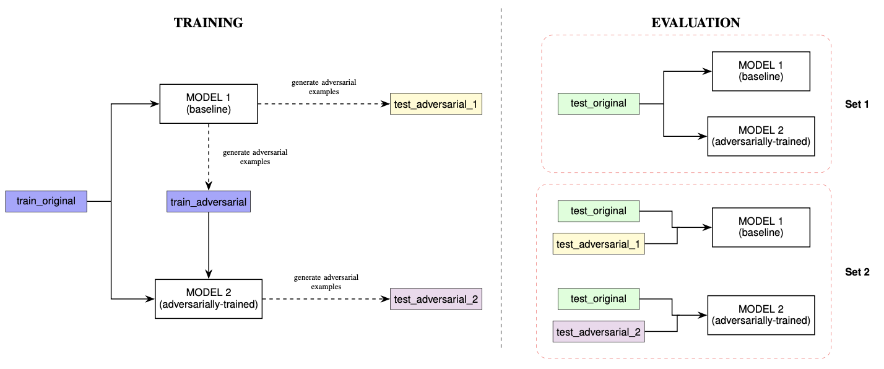

# DSA4266 Group 7: Adversarial ML for Phishing URL Detection

How vulnerable are URL-based phishing detectors (char-CNN, char-BiLSTM, URLBERT) to adversarial URL edits, and does adversarial training help?

Dataset: [PhiUSIIL Phishing URL](https://archive.ics.uci.edu/dataset/967/phiusiil+phishing+url+dataset) (235,795 URLs), URL string only. Label `0` = phishing (positive class), `1` = legitimate. After cleaning (dedup, drop scheme/`www`/trailing slash), 231,747 URLs are split 80:10:10 grouped by domain, so no domain appears in more than one split.

## Pipeline



Each model goes through the same three steps:
1. **MODEL 1 (baseline)**: train on `train_original`.
2. **Generate adversarial examples**: attack MODEL 1 to make `train_adversarial` (from train) and `test_adversarial_1` (from test).
3. **MODEL 2 (adversarially trained)**: train on `train_original + train_adversarial` with the same recipe, then attack MODEL 2 to make `test_adversarial_2`.

Evaluation:
- **Set 1**: MODEL 1 and MODEL 2 on clean `test_original` (recall, precision, FPR).
- **Set 2**: each model on `test_original` + adversarial URLs generated against that model (MODEL 1 with `test_adversarial_1`, MODEL 2 with `test_adversarial_2`); robust recall and attack success rate (ASR).

**Attack**: white-box, gradient-guided greedy character edits (insert/delete/substitute), at most 3 edits (Levenshtein), only in the subdomain, path, query and fragment; the registered domain and TLD are never changed. A URL is attacked only if the model correctly flags it as phishing; the attack succeeds when `P(phishing) < 0.5`.

## Results
Each model is attacked with adversarial URLs generated against itself. Phishing is the positive class.

**Adversarial training reduces attack success rate (ASR) for every model, but doesn't remove the vulnerability entirely.** Robustness ranking: CNN > BiLSTM > URLBERT.

| Model | ASR MODEL 1 | ASR MODEL 2 | FPR MODEL 1 → MODEL 2 (clean data) |
|---|---|---|---|
| CNN | 4.19% | 0.70% | 3.44% → 2.40% |
| BiLSTM | 9.38% | 0.83% | 2.39% → 2.57% |
| URLBERT | 40.99% | 4.67% | 2.17% → 3.86% |

**Baselines (MODEL 1) look similar on clean data**, but overall recall is inflated by `web.app`: it makes up ~58% of test phishing URLs and is caught almost perfectly. Phishing URLs outside `web.app` are the real test of generalisation.

| Model | Accuracy | Recall (all) | Recall (non-`web.app`) | F1 |
|---|---|---|---|---|
| CNN | 90.43% | 81.90% | 57.08% | 87.74% |
| BiLSTM | 90.77% | 81.25% | 55.54% | 88.04% |
| URLBERT | 90.26% | 79.73% | 53.04% | 87.25% |

**Small character edits expose large vulnerabilities in MODEL 1.** Robust recall is the share of all test phishing URLs still detected after the attack (higher is better). ASR is the share of attacked phishing URLs flipped to "legitimate" (lower is better).

| Model | Robust recall: all / `web.app` / other | ASR: all / `web.app` / other |
|---|---|---|
| CNN | 78.46% / 99.63% / 49.45% | 4.19% / 0.37% / 13.37% |
| BiLSTM | 73.62% / 99.79% / 37.76% | 9.38% / 0.21% / 32.01% |
| URLBERT | 47.05% / 46.92% / 47.22% | 40.99% / 52.70% / 10.97% |

The character-level CNN and BiLSTM are mostly fooled on non-`web.app` URLs. The subword-based URLBERT is mostly fooled on `web.app`.

## Notebooks
Run `eda/` first, then each model folder in order, following the three steps in [Pipeline](#pipeline):
1. Train MODEL 1.
2. Attack MODEL 1 to generate adversarial train/test sets.
3. Train MODEL 2 on original + adversarial train data, then attack MODEL 2 to generate its own adversarial test set.

Weights are saved to `models/` or `checkpoints/` (not in git).

| Notebook | Step | What it does |
|---|---|---|
| `eda/cleaning_and_eda` | Data cleaning | Cleans the raw CSV, EDA, domain-grouped splits, builds `vocab.json` / `config.json` |
| `cnn/cnn_baseline` | 1 | Train CNN MODEL 1, evaluate on `test_original` |
| `cnn/cnn_adversarial` | 2 | Attack MODEL 1 on train and test, build original + adversarial sets |
| `cnn/cnn_model2` | 3 | Train CNN MODEL 2, attack it on test, Set 1/2 evaluation by group |
| `bilstm/bilstm_model1` | 1 | Tune and train BiLSTM MODEL 1, evaluate on `test_original` |
| `bilstm/bilstm_generate_examples_train` | 2 | Attack MODEL 1 on train → `bilstm_adv_train.csv` |
| `bilstm/bilstm_generate_examples_test` | 2 | Attack MODEL 1 on test → `bilstm_adv_test.csv`, evaluate MODEL 1 |
| `bilstm/bilstm_model2` | 3 | Train BiLSTM MODEL 2, attack it on test, Set 1/2 evaluation by group |
| `urlbert/urlbert_train_model1` | 1 | Fine-tune URLBERT MODEL 1, evaluate on `test_original` |
| `urlbert/urlbert_generate_train_adversarial` | 2 | Attack MODEL 1 on train → `train_adversarial` |
| `urlbert/urlbert_generate_test_adversarial_1` | 2 | Attack MODEL 1 on test → `test_adversarial_1`, evaluate MODEL 1 |
| `urlbert/urlbert_train_model2` | 3 | Train URLBERT MODEL 2, evaluate by group |
| `urlbert/urlbert_generate_test_adversarial_2` | 3 | Attack MODEL 2 on test → `test_adversarial_2` |
| `urlbert/urlbert_eval_model2` | 3 | `urlbert_train_model2` + Set 2 evaluation of MODEL 2 on `test_adversarial_2` |
| `urlbert/urlbert_generate_train_adversarial_2` | Extra | Attack MODEL 2 on train (not part of the pipeline above) |
| `analysis/compare_training_curves` | Analysis | Training/validation loss of all three models on shared axes |
| `analysis/embedding_plot` | Analysis | PCA of penultimate-layer embeddings: clean vs adversarial URLs, MODEL 1 vs 2 |

## Structure
```
data/
  raw/                  original PhiUSIIL csv
  train.csv, val.csv, test.csv, vocab.json, config.json   cleaned splits (from eda/cleaning_and_eda)
  adversarial/{cnn,bilstm,urlbert}/   adversarial URLs per model
notebooks/
  eda/                  cleaning + EDA (run first)
  cnn/, bilstm/, urlbert/   train MODEL 1, generate adversarial examples, train/eval MODEL 2
  analysis/             cross-model loss curves, embedding plots
src/                    shared code
  load_data.py          load splits, config, vocab
  evaluate.py           metrics (clean + adversarial), save predictions
  generate_bilstm_adversarial.py, validate_adv.py
models/                 model weights (URLBERT config + vocab in git; most .pt not in git)
results/
  {cnn,bilstm,urlbert}/ metrics, plots, prediction csvs per model
  embeddings/           embedding plots + projector files
docs/                   pipeline diagram
```
